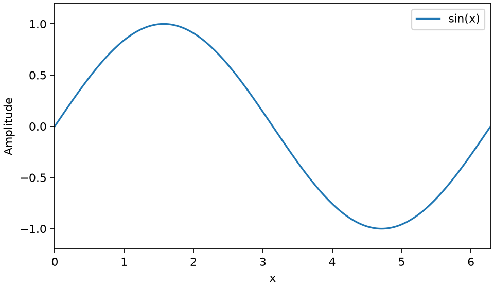
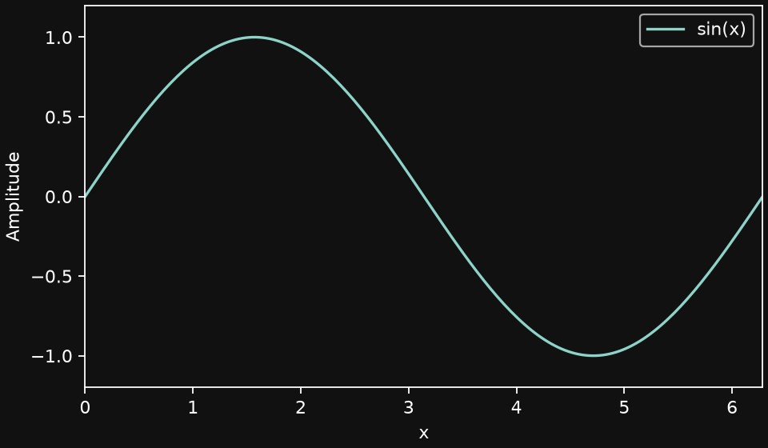

# Working with the course sources

## Python sources

Each published Python chapter has a `.py` file in `notebooks/`. This directory is retained so that imports of `lecture_utils` and paths to datasets continue to work. Edit these **Python files**; the original `.ipynb` files for the revised first lecture and exercise are replaced.

Scripts use [Jupytext's percent format](https://jupytext.readthedocs.io/en/latest/formats-scripts.html), which [Quarto renders directly](https://quarto.org/docs/computations/render-scripts.html):

```python
# %% [markdown]
# ---
# title: My chapter
# jupyter: python3
# ---
#
# ## Explanation
# Write Markdown, equations, or HTML here.

# %%
import matplotlib.pyplot as plt
plt.plot([0, 1, 2], [0, 1, 4])
plt.show()
```

`# %%` starts a code cell; `# %% [markdown]` starts a prose cell. Editors including VS Code and Spyder can run individual cells. You can also run a chapter as an ordinary Python script:

```bash
cd notebooks
python ml_cfd_intro.py
```

Use `print(...)` for terminal output and `plt.show()` for interactive figures when running plain Python. Quarto also displays the last expression in a cell and captures Matplotlib figures automatically.

The course code still requires its scientific packages and datasets. Use your existing course environment, with a Python version compatible with `requirements.txt`; the small website environment does not include PyTorch, flowTorch, or OpenFOAM.

## Install Quarto

Install [Quarto](https://quarto.org/docs/get-started/) (tested with 1.10.18). In your course Python environment, install the rendering dependencies:

```bash
python -m pip install -r requirements-quarto.txt
```

Quarto uses a Jupyter kernel internally, but you do not need to author or maintain notebook files or open JupyterLab.

For the project-local installation already created on this computer, from the repository root:

```bash
export PATH="$PWD/.tools/quarto-1.10.18/bin:$PATH"
export QUARTO_PYTHON="$PWD/.venv-quarto/bin/python"
```

For actual chapter execution, set `QUARTO_PYTHON` to the Python executable in your **course environment** instead.

## Rebuild the website from saved results

From the repository root:

```bash
quarto render
quarto preview --port 8002
```

Open the address printed by Quarto. `index.qmd` provides the overview; `_quarto.yml` defines the sidebar and site settings. The generated website is in `docs/`.

The project uses `freeze: true`. A whole-site render reuses the saved `_freeze/` results, so it does not rerun training or simulations. The initial freeze contains outputs saved in the original notebooks; these have **not** been recomputed or validated against today's dependencies. Preserve `_freeze/` in version control.

## Update a chapter and its results

After editing a Python chapter, explicitly render that chapter using the course environment:

```bash
quarto render notebooks/ml_cfd_intro.py
quarto render
```

The first command executes the chapter and refreshes its frozen results; the second rebuilds the complete site. This may require datasets and take time. A whole-site render alone will continue showing the previously frozen chapter, including its previous prose and code.

For a quick check of edited text and code without execution:

```bash
quarto render notebooks/ml_cfd_intro.py --no-execute
```

This produces a temporary page **without computed outputs**. Run `quarto render` afterward to restore the saved-output edition, or execute the chapter to update it.

Existing notebook shell commands were converted to `pathlib`; timing magics now use `timeit.repeat`. Deliberate error demonstrations in the Python refresher catch and print their errors, including an intentionally malformed example passed to `exec`, so the complete script remains valid Python.

## GitHub Pages

The site consists of static HTML, JavaScript, CSS, and images. Students can read it without a Python server. After rendering, commit `docs/`, `_freeze/`, the Python sources, and the Quarto project files. In the repository's **Settings → Pages**, choose **Deploy from a branch**, your publishing branch, and **`/docs`**. The `.nojekyll` file is included automatically. Deployment has not been enabled or changed as part of this migration.

## Conversion record

`quarto-migration.json` records the first lecture and exercise converted to Python chapters. Lecture 0 is authored directly in Quarto Markdown. Only these materials are included in the current website build. Saved results for the Python chapters remain in `_freeze/` and can be refreshed by rendering those chapters. Upcoming chapters are not part of this publication.

Run `python scripts/check_quarto.py` after a build to check Python syntax, chapter downloads, saved figures, and local links.

## Light and dark figures

The website defaults to dark mode with a `#111111` background, matching the slides. The theme switch remembers a reader's choice.

For static GitHub Pages hosting, generate **both versions when running Python**, then let Quarto show the version matching the reader's selected theme. Changing themes in the browser does not run Python.

### Reusable saving helper

Use `save_theme_variants` from `notebooks/figure_utils.py`. Put the plotting commands in a function that creates and returns a new figure. Compute data and expensive model predictions **once, outside that function**.

```python
import matplotlib.pyplot as plt
from figure_utils import save_theme_variants

# Load or compute x and y once here.
x, y = [0, 1, 2], [0, 1, 4]

def draw():
    fig, ax = plt.subplots(figsize=(6, 3.5), layout="constrained")
    ax.plot(x, y)
    ax.set(xlabel="Time", ylabel="Value")
    return fig

save_theme_variants(draw, "media/example.png")
```

This saves `media/example-light.png` using `default`, and `media/example-dark.png` using `dark_background`, with the dark figure and axes backgrounds set to `#111111`. Pass `dark_background=None` for Matplotlib's unmodified black dark background. A `.svg` or `.pdf` filename produces that format; no extension defaults to PNG. Re-running replaces the previous pair.

The helper restores your Matplotlib settings and closes the generated figures. Both exports have the same canvas size. Use `layout="constrained"` to fit labels; avoid `plt.show()` inside `draw`. Styles apply when artists are created, so saving an already drawn figure under a different stylesheet does not reliably recolor it. Explicit colors such as `color="black"` also override styles; prefer the color cycle or theme-aware colors.

### Include the pair in Quarto

In a chapter's Markdown cell:

```python
# %% [markdown]
# {.light-content}
# {.dark-content}
```

Only the matching image is visible. Keep the data and axis limits consistent across both versions. Existing saved figures retain their appearance until their plotting code uses this workflow and is rerun.

### Runnable example

From the repository root, using your course environment:

```bash
python notebooks/figure_example.py
quarto render
```

The example saves the following pair, which switches with the site's theme toggle:

{.light-content}
{.dark-content}

The helper and example are available as [figure_utils.py](notebooks/figure_utils.py){download="figure_utils.py" data-noresolveinput="true"} and [figure_example.py](notebooks/figure_example.py){download="figure_example.py" data-noresolveinput="true"}. Place the helper beside a downloaded chapter when running it outside this repository.

See [Quarto's mode-specific content documentation](https://quarto.org/docs/output-formats/html-themes.html#mode-specific-content) and [Matplotlib style contexts](https://matplotlib.org/stable/users/explain/customizing.html).
