## Why look for coherent structures?

::: {.callout-note title="Definition of a coherent structure" icon=false}
A **coherent structure** is a recognizable flow pattern whose spatially correlated features evolve together in an organized way. When the pattern recurs, different parts of the flow may retain a consistent phase relationship from one cycle to the next, as in periodic vortex shedding. A coherent pattern can also persist for a finite time or recur irregularly. [@hussain1986coherent]
:::

We are particularly interested in structures that dominate a quantity we care about, such as the unsteady lift on an airfoil. A physically interpretable pattern can tell us where to measure, which timescales matter, and where an actuator might influence the flow. How important a structure is depends on what we measure and what we want to predict or control.

### Transonic shock buffet on an airfoil

In transonic flow, the air can accelerate to supersonic speed over the suction side of an airfoil and decelerate through a shock. Under buffet conditions, the shock and boundary layer interact in a self-sustained unsteady motion. This aerodynamic phenomenon is called **transonic shock buffet**. The shock moves back and forth, and downstream of it the boundary layer can separate in the subsonic flow. The separated region can grow and shrink over the buffet cycle, sometimes as a pulsating separation bubble. Vortices can also shed near the trailing edge. [@jacquin2009shock; @daguanno2021buffet]

{.light-content width=100%}
{.dark-content width=100%}

*Conceptual sketch of shock motion, a changing separated region, and a wavy wake with alternating vortices. The dashed state shows the upstream shock and larger separated region. The solid state shows the downstream shock and smaller separated region. The geometry and positions are illustrative.*

Shock motion and changes in separation can be organized over the same buffet cycle, while vortices can shed on a much shorter timescale. In the OAT15A wind-tunnel experiment at $M_\infty=0.70$ and $\alpha=3.5^\circ$, the dominant shock oscillation was at $St_c\approx0.07$, where $St_c=fc/U_\infty$ uses the airfoil chord $c$ and the freestream speed $U_\infty$. For vortices in the separated shear layer, the authors estimated $St_c\approx2.2$–$3.5$ from their wavelength and convection speed. This gives a sense of the separation in timescales. The size of the separated region still varies over the slower buffet cycle, changing the environment in which those faster vortices develop. [@daguanno2021buffet]

The resulting unsteady aerodynamic loads can excite structural modes and produce a strong aeroelastic response, called **buffeting**. To predict where it may occur in a flight envelope, we can first map aerodynamic buffet onset in freestream Mach number $M_\infty$ and angle of attack $\alpha$, then assess how the loads excite the structure. Characterizing the shock and separation also helps us design passive changes to the airfoil or active flow control.

## Measured cylinder wake dataset

For a full-field example, we use planar particle image velocimetry (PIV) from a water-channel experiment at a cylinder Reynolds number of $413$. The cylinder diameter was $9.5\,\mathrm{mm}$. The dataset contains 8,000 snapshots on a $135\times80$ grid, sampled at $20\,\mathrm{Hz}$ in the midspan plane. The MATLAB file contains both in-plane velocity components, $u$ and $v$ in $\mathrm{m/s}$, and the coordinate grids $x$ and $y$ in meters. The cylinder and laser-shadow regions are marked by zeros in the source file. [@shang2026piv; @tu2014spectral]

The [companion code notebook](coherent_structures_code.py) shows how we download and process the PIV data and reproduce the figures and animations.

In the figures and animations, we plot positions as $x/D$ and $y/D$, keeping the origin of the released coordinate grid. We scale velocities, their fluctuations and statistics, and the POD time coefficients by the reported inflow speed $U_\infty=0.0435\,\mathrm{m/s}$ [@tu2014spectral]. The unit-norm spatial modes are already dimensionless. The time-history plots use convective time $tU_\infty/D$, with one convective time unit $D/U_\infty\approx0.218\,\mathrm{s}$. The animations display elapsed seconds. We retain dimensional velocities in the worked covariance calculation below.

The animation shows both components side by side for the first eight seconds at the measured sampling rate. The color limits stay fixed within each panel and clip rare extremes to make the wake visible. We use rounded 0.5th and 99.5th percentiles for $u$ and a symmetric limit based on the 99.5th percentile of $|v|$. The circular patch uses the reported diameter and an approximate center at $(x,y)=(-45.0,-26.67)\,\mathrm{mm}$. The streamwise coordinate is a visual estimate from the mask, and the cross-stream coordinate is the midpoint of the two probes. The surrounding gray area marks locations excluded from the measurements.

<video class="light-content" controls loop muted playsinline preload="metadata" width="100%" poster="media/coherent-piv-light.png" aria-label="Measured streamwise and transverse velocity in the cylinder wake"><source src="media/coherent-piv-light.mp4" type="video/mp4"></video>
<video class="dark-content" controls loop muted playsinline preload="metadata" width="100%" poster="media/coherent-piv-dark.png" aria-label="Measured streamwise and transverse velocity in the cylinder wake"><source src="media/coherent-piv-dark.mp4" type="video/mp4"></video>

The temporal mean and sample standard deviation are computed separately at every valid grid location, using all 8,000 samples. The mean streamwise velocity shows the wake deficit. The standard deviations show where each component fluctuates most over the record.

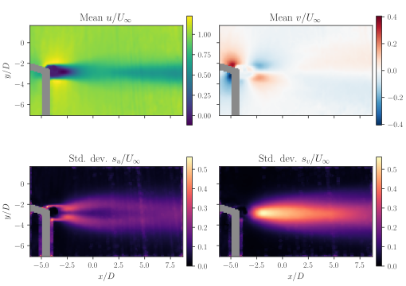{.light-content width=100%}
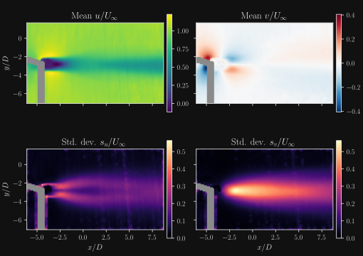{.dark-content width=100%}

*Temporal statistics of the measured wake. The two standard deviation panels share a color scale. Gray shows the source mask, which includes both the cylinder and its optical shadow. The dark pocket nearby contains unmasked samples with low streamwise fluctuations.*

## Coherence between two wake probes {#principal-component-analysis-with-two-wake-probes}

Before working with the full images, we choose two grid points in the measured wake at the two local peaks in the temporal standard deviation of streamwise velocity. We search the near wake between two and three diameters downstream of the estimated cylinder center, within 1.5 diameters on each side of the search reference line at $y=-23.5\,\mathrm{mm}$. We use the upper peak for probe 2 and place probe 1 at the same streamwise station, at the cross-stream coordinate of the lower peak. We treat these grid points as virtual probes and use their streamwise velocities.

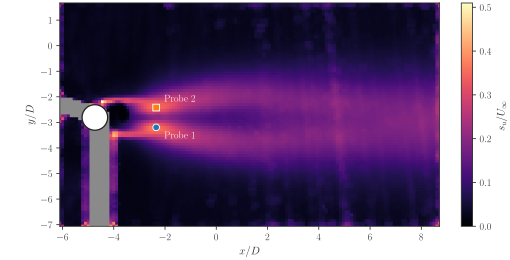{.light-content width=100%}
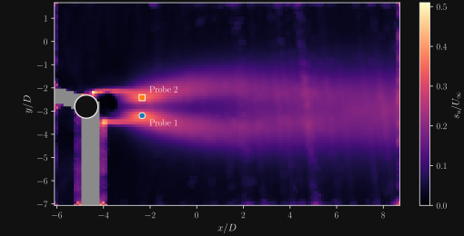{.dark-content width=100%}

*The two probes at the same streamwise station on the streamwise velocity standard deviation map. Probe 1 is at $(x,y)\approx(-22.28,-30.35)\,\mathrm{mm}$ and probe 2 is at $(-22.28,-23.00)\,\mathrm{mm}$.*

### Mean, fluctuations, variance, and covariance

We write $u_i(t_n)$ for the streamwise velocity at probe $i=1,2$, sampled at time $t_n=t_0+n\Delta t$ for $n=0,\ldots,N-1$. Here $N=8000$, $t_0=0$, and $\Delta t=0.05\,\mathrm{s}$. The sample mean and the fluctuation about that mean are

$$
\bar u_i=\frac{1}{N}\sum_{n=0}^{N-1}u_i(t_n),
\qquad
u_i^\prime(t_n)=u_i(t_n)-\bar u_i.
$$

The **sample variance** measures the squared spread of each signal around its mean. The **sample covariance** measures how two signals vary together.

$$
s_i^2=\frac{1}{N-1}\sum_{n=0}^{N-1}\bigl(u_i^\prime(t_n)\bigr)^2,
\qquad
C_{ij}=\frac{1}{N-1}\sum_{n=0}^{N-1}u_i^\prime(t_n)u_j^\prime(t_n).
$$

In particular, $C_{ii}=s_i^2$. When the two fluctuations usually have opposite signs, their products tend to be negative and so does their covariance. This definition uses the sample covariance convention throughout. The time samples can be correlated, as they are here.

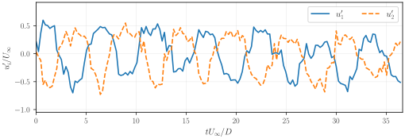{.light-content width=100%}
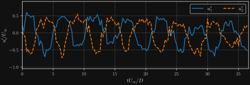{.dark-content width=100%}

*An eight-second excerpt of the two measured probe signals. The statistics use all 8,000 samples.*

We can also compare the simultaneous fluctuations in probe coordinates $(u_1^\prime,u_2^\prime)$. The scatter plot draws one marker per pair, so markers overlap where samples are concentrated. The plot on the right divides the plane into hexagons and colors each one by its sample count. The densest regions lie along a band near $u_2^\prime=-u_1^\prime$. The spread across that band shows the error we should expect when we approximate $u_2^\prime$ by $-u_1^\prime$.

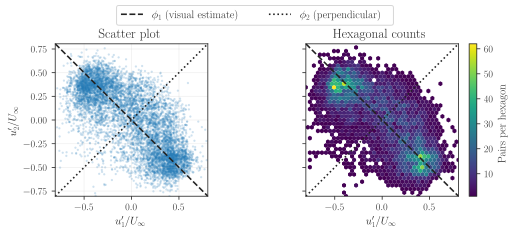{.light-content width=100%}
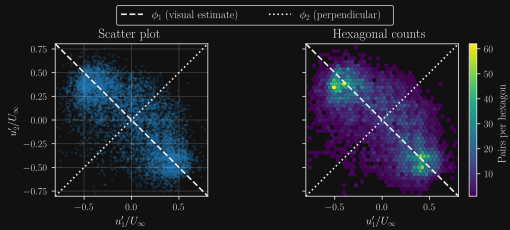{.dark-content width=100%}

*Paired samples in probe coordinates. In the right panel, color shows the number of pairs per hexagon on a linear scale. Nine pairs lie outside the plotted range. All 8,000 pairs enter the covariance calculation.*

By eye, we can choose the orthonormal directions

$$
\boldsymbol{\phi}_1=\frac{1}{\sqrt{2}}\begin{bmatrix}1\\-1\end{bmatrix},
\qquad
\boldsymbol{\phi}_2=\frac{1}{\sqrt{2}}\begin{bmatrix}1\\1\end{bmatrix}.
$$

Most of the variation is along $\boldsymbol{\phi}_1$. If we know $u_1^\prime$, we can estimate $u_2^\prime$ as $-u_1^\prime$. Alternatively, we can describe both probes with a single coordinate along the diagonal. This is the idea behind dimensionality reduction and gives us a compact state to work with in reduced-order modeling.

### Snapshots and projection

At time $t_n$, we collect both fluctuations in a column vector. The columns of $\mathbf X$ are the snapshots, so space varies along the rows and time along the columns.

$$
\mathbf u^\prime(t_n)=
\begin{bmatrix}u_1^\prime(t_n)\\u_2^\prime(t_n)\end{bmatrix},
\qquad
\mathbf X=
\begin{bmatrix}\mathbf u^\prime(t_0)&\mathbf u^\prime(t_1)&\cdots&
\mathbf u^\prime(t_{N-1})\end{bmatrix}
\in\mathbb R^{2\times N}.
$$

For any unit vector $\boldsymbol{\phi}_i$, the dot product with a snapshot gives its coordinate along that axis. We can project all the snapshots at once and collect the coordinates in a row vector $\mathbf y_i$. Its entry $y_{i,n}$ is the time coefficient of snapshot $n$ along axis $i$. Stacking the row vectors gives the data matrix $\mathbf Y$ in the new coordinates.

$$
\mathbf y_i=\boldsymbol{\phi}_i^\mathsf{T}\mathbf X
\in\mathbb R^{1\times N},
\qquad
\mathbf Y=\boldsymbol{\Phi}^\mathsf{T}\mathbf X,
\qquad
\boldsymbol{\Phi}=\begin{bmatrix}\boldsymbol{\phi}_1&\boldsymbol{\phi}_2\end{bmatrix}.
$$

The rows of $\mathbf X$ have zero sample mean, so the projected rows do too. We can compute the temporal sample variance along axis $i$ directly from $\mathbf y_i$.

$$
\begin{aligned}
\operatorname{var}(\mathbf y_i)
&=\frac{1}{N-1}\mathbf y_i\mathbf y_i^\mathsf{T}\\
&=\boldsymbol{\phi}_i^\mathsf{T}
  \left(\frac{\mathbf X\mathbf X^\mathsf{T}}{N-1}\right)
  \boldsymbol{\phi}_i
=\boldsymbol{\phi}_i^\mathsf{T}\mathbf C\boldsymbol{\phi}_i .
\end{aligned}
$$

The matrix in parentheses is the covariance in the original probe coordinates. In the rotated coordinates, it becomes $\mathbf C_Y=\mathbf Y\mathbf Y^\mathsf{T}/(N-1)=\boldsymbol{\Phi}^\mathsf{T}\mathbf C\boldsymbol{\Phi}$. With our axes estimated by eye, the matrices are approximately

$$
\mathbf C=
\begin{bmatrix}
24.9550 & -17.6191\\
-17.6191 & 23.2607
\end{bmatrix}
\times10^{-5}\,\mathrm{m^2/s^2},
\qquad
\mathbf C_Y=
\begin{bmatrix}
41.7270 & 0.8471\\
0.8471 & 6.4887
\end{bmatrix}
\times10^{-5}\,\mathrm{m^2/s^2}.
$$

The rotation concentrates the variance in the first coordinate and reduces the cross-covariance. Can we choose the rotation from the data and make the cross-covariance exactly zero?

### Finding the principal axes

**Principal component analysis (PCA)** chooses the first unit axis to maximize the variance of the projected data. Each subsequent axis maximizes the remaining variance subject to being orthogonal to the axes already chosen. The unit-length constraint lets us compare directions without changing the scale.

For the first axis, we maximize $\boldsymbol{\phi}_1^\mathsf{T}\mathbf C\boldsymbol{\phi}_1$ subject to $\boldsymbol{\phi}_1^\mathsf{T}\boldsymbol{\phi}_1=1$. With the multiplier $\lambda_1$, the Lagrangian is

$$
\mathcal L_1(\boldsymbol{\phi}_1,\lambda_1)
=\boldsymbol{\phi}_1^\mathsf{T}\mathbf C\boldsymbol{\phi}_1
-\lambda_1(\boldsymbol{\phi}_1^\mathsf{T}\boldsymbol{\phi}_1-1).
$$

We differentiate with respect to the first axis $\boldsymbol{\phi}_1$. The quadratic term contains $\boldsymbol{\phi}_1$ in both factors, which give $\mathbf C\boldsymbol{\phi}_1$ and $\mathbf C^\mathsf{T}\boldsymbol{\phi}_1$ by the product rule. Since $\mathbf C$ is symmetric, the two stationarity conditions are

$$
\begin{aligned}
\nabla_{\boldsymbol{\phi}_1}\mathcal L_1
&=2\mathbf C\boldsymbol{\phi}_1-2\lambda_1\boldsymbol{\phi}_1=\mathbf 0,\\
\frac{\partial\mathcal L_1}{\partial\lambda_1}
&=1-\boldsymbol{\phi}_1^\mathsf{T}\boldsymbol{\phi}_1=0.
\end{aligned}
$$

The derivative with respect to $\lambda_1$ recovers the unit-length constraint we put into the problem. The multiplier appears linearly, so setting its derivative to zero forces the constraint residual $1-\boldsymbol{\phi}_1^\mathsf{T}\boldsymbol{\phi}_1$ to vanish. The gradient with respect to $\boldsymbol{\phi}_1$ gives the eigenvalue equation $\mathbf C\boldsymbol{\phi}_1=\lambda_1\boldsymbol{\phi}_1$. For a unit vector satisfying that equation, the projected variance is $\boldsymbol{\phi}_1^\mathsf{T}\mathbf C\boldsymbol{\phi}_1=\lambda_1$. Each unit eigenvector is a candidate, and choosing the largest eigenvalue gives the largest variance.

::: {.callout-note collapse="true" title="Optional reading: differentiating the two-probe quadratic form"}
We write a trial axis as $\boldsymbol{\phi}=(a,b)^\mathsf{T}$ and the two-probe covariance as $\mathbf C=\left[\begin{smallmatrix}C_{11}&C_{12}\\C_{12}&C_{22}\end{smallmatrix}\right]$. First, the matrix times the vector gives two linear expressions. Taking the dot product with the same vector then gives a scalar quadratic in $a$ and $b$:

$$
\begin{aligned}
q(a,b)
&=\boldsymbol{\phi}^\mathsf{T}\mathbf C\boldsymbol{\phi}\\
&=\begin{bmatrix}a&b\end{bmatrix}
\begin{bmatrix}C_{11}a+C_{12}b\\C_{12}a+C_{22}b\end{bmatrix}\\
&=C_{11}a^2+2C_{12}ab+C_{22}b^2\\
&\approx 10^{-5}\left(24.9550a^2-35.2382ab+23.2607b^2\right)\,\mathrm{m^2/s^2}.
\end{aligned}
$$

The gradient with respect to $\boldsymbol{\phi}$ is a column vector. Its first entry is the derivative with respect to $a$ with $b$ held fixed. Its second entry is the derivative with respect to $b$ with $a$ held fixed:

$$
\nabla_{\boldsymbol{\phi}}q
=\begin{bmatrix}\partial q/\partial a\\\partial q/\partial b\end{bmatrix}
=\begin{bmatrix}2C_{11}a+2C_{12}b\\2C_{12}a+2C_{22}b\end{bmatrix}
=2\mathbf C\boldsymbol{\phi}.
$$

The gradient of the constraint residual $a^2+b^2-1$ is $\begin{bmatrix}2a&2b\end{bmatrix}^\mathsf{T}$. With $\lambda_1$ held fixed, the two partial derivatives of the Lagrangian therefore give

$$
\begin{aligned}
C_{11}a+C_{12}b &= \lambda_1 a,\\
C_{12}a+C_{22}b &= \lambda_1 b.
\end{aligned}
$$

These are the two rows of $\mathbf C\boldsymbol{\phi}=\lambda_1\boldsymbol{\phi}$. The derivative with respect to $\lambda_1$ supplies $a^2+b^2=1$.
:::

For the second axis, we keep $\boldsymbol{\phi}_1$ fixed and add the constraint $\boldsymbol{\phi}_1^\mathsf{T}\boldsymbol{\phi}_2=0$. With a second multiplier $\mu$, we obtain

$$
\begin{aligned}
\mathcal L_2
&=\boldsymbol{\phi}_2^\mathsf{T}\mathbf C\boldsymbol{\phi}_2
-\lambda_2(\boldsymbol{\phi}_2^\mathsf{T}\boldsymbol{\phi}_2-1)
-2\mu\,\boldsymbol{\phi}_1^\mathsf{T}\boldsymbol{\phi}_2,\\
\nabla_{\boldsymbol{\phi}_2}\mathcal L_2
&=2\mathbf C\boldsymbol{\phi}_2-2\lambda_2\boldsymbol{\phi}_2
-2\mu\boldsymbol{\phi}_1=\mathbf 0.
\end{aligned}
$$

The derivatives with respect to $\lambda_2$ and $\mu$ enforce unit length and orthogonality. Multiplying the gradient equation on the left by $\boldsymbol{\phi}_1^\mathsf{T}$ gives $-2\mu=0$, since symmetry gives $\boldsymbol{\phi}_1^\mathsf{T}\mathbf C\boldsymbol{\phi}_2=\lambda_1\boldsymbol{\phi}_1^\mathsf{T}\boldsymbol{\phi}_2=0$. Thus $\mathbf C\boldsymbol{\phi}_2=\lambda_2\boldsymbol{\phi}_2$, and we take the largest eigenvalue available in the subspace orthogonal to $\boldsymbol{\phi}_1$.

For each subsequent axis, we add one orthogonality constraint for every axis already chosen. Taking the dot product with each earlier axis eliminates its multiplier in the same way. Because a real symmetric matrix has an orthonormal eigenbasis, we can continue choosing the largest eigenvalue in the remaining subspace. Within a repeated eigenvalue's eigenspace, any orthonormal choice gives the same variance.

The entries of $\boldsymbol{\Phi}^\mathsf{T}\boldsymbol{\Phi}$ are the pairwise dot products of the unit eigenvectors. They are one on the diagonal and zero elsewhere. For the full square basis, this gives $\boldsymbol{\Phi}^{-1}=\boldsymbol{\Phi}^\mathsf{T}$. Consequently,

$$
\mathbf C_Y=\boldsymbol{\Phi}^\mathsf{T}\mathbf C\boldsymbol{\Phi}
=\operatorname{diag}(\lambda_1,\lambda_2).
$$

The columns of $\boldsymbol{\Phi}$ are the **principal axes**. Each row vector $\mathbf y_i$ of $\mathbf Y$ contains the time-dependent **time coefficients** along axis $i$.

### What PCA finds in the probe data

For the measured probes, the first axis from the eigendecomposition is approximately $(0.724,-0.690)^\mathsf{T}$, about $1.4^\circ$ from our visual estimate $(0.707,-0.707)^\mathsf{T}$. We chose its sign to match the visual estimate. Flipping both the axis and its time coefficient gives the same reconstruction. The two eigenvalues are approximately $41.7474\times10^{-5}$ and $6.4684\times10^{-5}\,\mathrm{m^2/s^2}$. The first mode captures $86.6\%$ of the sample variance. The sample correlation between the two probes is $-0.731$.

We can therefore approximate each two-probe snapshot by multiplying the first time coefficient by the first axis and adding back the probe means.

$$
\widehat{\mathbf u}(t_n)
=\overline{\mathbf u}+\boldsymbol{\phi}_1\,y_{1,n}.
$$

Here $y_{1,n}$ is the first time coefficient at time $t_n$.

### Reading the entries of a principal axis

The time coefficient tells us how strongly a mode is present at a particular time. The entries of its principal axis, often called **loadings** when referring to the eigenvector weights, tell us how that time coefficient appears at each probe. In the first mode, a positive time coefficient gives a positive contribution at probe 1 and a negative contribution at probe 2. A negative time coefficient reverses both. The relative signs indicate opposite motion within this mode.

More precisely, mode $k$ contributes $\lambda_k\phi_{ik}^2$ to the variance at location $i$ and $\lambda_k\phi_{ik}\phi_{jk}$ to the covariance between locations $i$ and $j$:

$$
C_{ii}=\sum_k\lambda_k\phi_{ik}^2,
\qquad
C_{ij}=\sum_k\lambda_k\phi_{ik}\phi_{jk}.
$$

Since each axis has unit length, $\phi_{ik}^2$ is the share of mode $k$'s variance assigned to location $i$. The eigenvalue $\lambda_k$ sets the total variance of the mode, so a large loading in a low-variance mode can still make a small contribution to the local variance. In our example, the first mode contributes negative covariance and the second contributes positive covariance. The first dominates, giving the negative covariance we observed. The net sign always depends on the sum over modes.

## From two probes to a full flow field

Suppose we now record the streamwise velocity at all $M$ spatial points at each of the $N$ sampling times. Each snapshot is a column of length $M$, and we subtract the sample mean at each point. The same PCA equations apply, with larger spatial dimensions:

$$
\mathbf X\in\mathbb R^{M\times N},\qquad
\mathbf C=\frac{\mathbf X\mathbf X^\mathsf T}{N-1}\in\mathbb R^{M\times M},
\qquad
\mathbf C\boldsymbol{\phi}_k=\lambda_k\boldsymbol{\phi}_k,
\quad \boldsymbol{\phi}_k\in\mathbb R^M.
$$

For the PIV snapshots, we have two components at each of the $P=10{,}435$ valid grid points. We flatten each component in the same spatial order, center each row over time, and stack the $u$ block above the $v$ block:

$$
\mathbf x_n=
\begin{bmatrix}
u_1^\prime(t_n)\\ \vdots\\ u_P^\prime(t_n)\\[2pt]
v_1^\prime(t_n)\\ \vdots\\ v_P^\prime(t_n)
\end{bmatrix},
\qquad
\mathbf X=
\begin{bmatrix}
\mathbf X_u\\ \mathbf X_v
\end{bmatrix}
\in\mathbb R^{2P\times N}.
$$

Here $M$ counts the scalar entries in each snapshot, so $M=2P=20{,}870$ and $N=8{,}000$. We use an ordinary Euclidean dot product, giving equal weight to each component and grid point. The measured example has more rows than columns. A finer spatial grid or a shorter time record can make the difference much larger. For example, $10^5$ grid points and $10^3$ snapshots give an $M\times M$ covariance matrix with $10^{10}$ entries.

How many modes can have nonzero variance? The covariance has the same rank as $\mathbf X$, because $\mathbf z^\mathsf T\mathbf C\mathbf z=\|\mathbf X^\mathsf T\mathbf z\|^2/(N-1)$. Thus the null space of $\mathbf C$ equals that of $\mathbf X^\mathsf T$. Without centering, the rank can be at most $N$ in our case $M\gg N$. Centering gives $\mathbf X\mathbf 1=\mathbf 0$, so the sharper bound is $N-1$. Any further linear dependencies lower the rank again.

We only need modes with nonzero variance to represent the snapshots. In floating-point computations, a tolerance distinguishes numerically nonzero directions from roundoff. We may keep even fewer modes when an approximate reconstruction is sufficient.

## Economy singular value decomposition

We can compute the principal axes directly from the snapshot matrix using the **singular value decomposition** (SVD). For our tall matrix, the economy SVD is

$$
\underbrace{\mathbf X}_{M\times N}
=\underbrace{\mathbf U}_{M\times N}
 \underbrace{\boldsymbol{\Sigma}}_{N\times N}
 \underbrace{\mathbf V^\mathsf T}_{N\times N},
\qquad
\boldsymbol{\Sigma}=\operatorname{diag}(\sigma_1,\ldots,\sigma_N),
\quad \sigma_1\geq\cdots\geq\sigma_N\geq0.
$$

The columns $\mathbf u_k$ of $\mathbf U$ and $\mathbf v_k$ of $\mathbf V$ are the **left** and **right singular vectors**. Each pair is linked by $\mathbf X\mathbf v_k=\sigma_k\mathbf u_k$ and $\mathbf X^\mathsf T\mathbf u_k=\sigma_k\mathbf v_k$. The columns of each matrix are orthonormal:

$$
\mathbf U^\mathsf T\mathbf U=\mathbf I_N,\qquad
\mathbf V^\mathsf T\mathbf V=\mathbf V\mathbf V^\mathsf T=\mathbf I_N.
$$

The square $\mathbf V$ has an ordinary inverse. For the tall $\mathbf U$, the product $\mathbf U\mathbf U^\mathsf T$ is an $M\times M$ orthogonal projector of rank $N$. Since $M>N$, it differs from $\mathbf I_M$. When we project a vector $\mathbf z$ onto the columns of $\mathbf U$ and then map the coordinates back, we obtain $\mathbf U\mathbf U^\mathsf T\mathbf z$. This recovers $\mathbf z$ exactly whenever $\mathbf z$ already lies in their span. Indeed, if $\mathbf z=\mathbf U\mathbf a$, then

$$
\mathbf U\mathbf U^\mathsf T\mathbf z
=\mathbf U(\mathbf U^\mathsf T\mathbf U)\mathbf a
=\mathbf U\mathbf a=\mathbf z.
$$

The left singular vectors span the column space of $\mathbf X$ when we retain all directions with positive singular values, so every original snapshot is recovered exactly in exact arithmetic. A full $M$-vector orthonormal basis would also recover arbitrary vectors in $\mathbb R^M$.

The economy decomposition can still include zero singular values. If $r=\operatorname{rank}(\mathbf X)$, we obtain the **compact SVD** by retaining only $r$ columns of $\mathbf U$ and $\mathbf V$ and the corresponding positive diagonal of $\boldsymbol{\Sigma}$.

### Full and economy SVD

The full SVD extends $\mathbf U$ with $M-N$ orthonormal columns, collected in $\mathbf U_\perp$. The right factor $\mathbf V$ and the singular values are the same as in the economy SVD. We write

$$
\mathbf X
=\underbrace{\begin{bmatrix}\mathbf U & \mathbf U_\perp\end{bmatrix}}_{\mathbf U_{\mathrm f}\in\mathbb R^{M\times M}}
 \underbrace{\begin{bmatrix}\boldsymbol{\Sigma}\\\mathbf 0\end{bmatrix}}_{\boldsymbol{\Sigma}_{\mathrm f}\in\mathbb R^{M\times N}}
 \mathbf V^\mathsf T,
\qquad
\mathbf U_{\mathrm f}^\mathsf T\mathbf U_{\mathrm f}
=\mathbf U_{\mathrm f}\mathbf U_{\mathrm f}^\mathsf T=\mathbf I_M.
$$

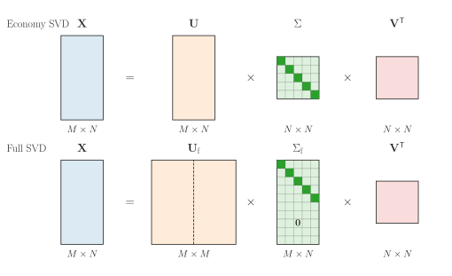{.light-content width=100%}
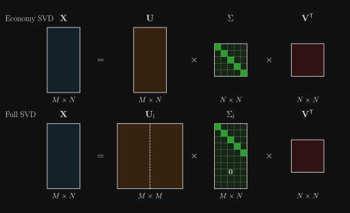{.dark-content width=100%}

*Matrix shapes for a tall snapshot matrix. The green cells mark singular-value positions, some of which can hold zeros. The dashed partition in the full left factor marks the added columns.*

The extra columns complete a basis for $\mathbb R^M$ and are orthogonal to every snapshot. They multiply zero rows in $\boldsymbol{\Sigma}_{\mathrm f}$, so they add no variance or reconstruction information. For $M\gg N$, storing the full left factor takes $M^2$ entries instead of $MN$, and computing its extra columns adds work. The economy SVD supplies the same reconstruction and PCA information using the smaller factors.

### Inversion with singular values

In our case $\mathbf X$ is rectangular, so the relevant inverse is the Moore–Penrose **pseudoinverse**. Using the compact factors, we reverse the order and invert only the positive singular values:

$$
\mathbf X^+=\mathbf V_r\boldsymbol{\Sigma}_r^{-1}\mathbf U_r^\mathsf T,
\qquad
\boldsymbol{\Sigma}_r^{-1}=\operatorname{diag}(1/\sigma_1,\ldots,1/\sigma_r).
$$

The result has shape $N\times M$. Given a target field $\mathbf b\in\mathbb R^M$, $\mathbf X^+\mathbf b$ gives the minimum-norm coefficients among the least-squares fits to $\mathbf X\mathbf a\approx\mathbf b$. Geometrically, we project $\mathbf b$ onto the left singular vectors, divide by their singular values, and map the result back through the right singular vectors. For a square, full-rank matrix, the same formula gives the ordinary inverse. Small singular values amplify errors in the target, so truncating tiny values can make the fit less sensitive to noise.

### Spatial modes and time coefficients

Inserting the economy SVD into the spatial covariance gives

$$
\mathbf C
=\frac{\mathbf U\boldsymbol{\Sigma}\mathbf V^\mathsf T
       \mathbf V\boldsymbol{\Sigma}\mathbf U^\mathsf T}{N-1}
=\mathbf U\frac{\boldsymbol{\Sigma}^2}{N-1}\mathbf U^\mathsf T.
$$

The left singular vectors with $\sigma_k>0$ therefore give the principal axes, with $\lambda_k=\sigma_k^2/(N-1)$. Projection onto those axes gives the same time coefficients as before:

$$
\mathbf Y=\mathbf U_r^\mathsf T\mathbf X
=\boldsymbol{\Sigma}_r\mathbf V_r^\mathsf T,
\qquad
y_{k,n}=\sigma_k(\mathbf v_k)_n.
$$

Each snapshot is a sum of fixed spatial patterns with time-dependent amplitudes:

$$
\mathbf u^\prime(t_n)=\sum_{k=1}^r \mathbf u_k\,y_{k,n}.
$$

This separation of space and time is what makes this a **modal analysis**. A spatial mode shows where and how the field varies, while its time coefficient shows when it is active and with what sign. For flow fields this decomposition is also called **proper orthogonal decomposition** (POD), with the modes here orthonormal in our chosen spatial dot product. PCA uses the covariance across snapshots, which is unchanged if we shuffle their order. We can analyze the ordered time coefficients afterward to look for frequencies and phase relationships. An individual mode can contain several frequencies.

## Method of snapshots

When $M\gg N$, we can solve the eigenproblem in snapshot space instead. The **method of snapshots** uses the smaller Gram matrix whose entries are dot products between snapshots. [@sirovich1987coherent]

$$
\widetilde{\mathbf C}=\frac{\mathbf X^\mathsf T\mathbf X}{N-1}
\in\mathbb R^{N\times N}.
$$

The SVD gives $\widetilde{\mathbf C}=\mathbf V\boldsymbol{\Sigma}^2\mathbf V^\mathsf T/(N-1)$. The two matrices share the positive eigenvalues, and the eigenvectors of $\widetilde{\mathbf C}$ are the right singular vectors. After solving $\widetilde{\mathbf C}\mathbf v_k=\lambda_k\mathbf v_k$ for a positive $\lambda_k$, we recover the spatial mode and its time coefficients using

$$
\boldsymbol{\phi}_k=\frac{\mathbf X\mathbf v_k}{\sqrt{(N-1)\lambda_k}},
\qquad
\mathbf y_k=\sqrt{(N-1)\lambda_k}\,\mathbf v_k^\mathsf T.
$$

The spatial formula works because $\mathbf X\mathbf v_k$ is an eigenvector of $\mathbf C$ with the same eigenvalue, and its norm is $\sqrt{(N-1)\lambda_k}$. We skip directions with numerically zero eigenvalues before dividing. In the grid example, we store $10^6$ entries in the snapshot matrix $\widetilde{\mathbf C}$ instead of $10^{10}$ in the spatial covariance. Forming the Gram matrix squares the condition number on the nonzero spectrum, so a direct economy SVD can resolve weak modes more accurately when those modes matter.

## POD of the measured cylinder wake

We apply a truncated SVD to all 8,000 centered snapshots of the two velocity components. The solver works directly with the stacked snapshot matrix and returns the 20 leading modes.

### How quickly does the variance decay?

For centered snapshots, $\lambda_k=\sigma_k^2/(N-1)$. The fraction of variance explained by mode $k$ is therefore $\sigma_k^2/\|\mathbf X\|_F^2$, where $\|\mathbf X\|_F^2$ is the sum of all squared fluctuation entries. We use this full sum even though we compute only the leading 20 singular values.

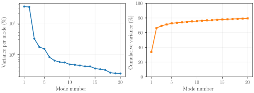{.light-content width=100%}
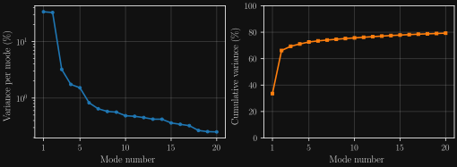{.dark-content width=100%}

*The left panel shows each mode’s variance fraction on a logarithmic scale. The right panel shows the cumulative fraction.*

The first five modes capture 72.6% of the variance, with 66.1% already captured by the first two. Mode six contributes 0.82%, and the contributions decay more slowly from there across the plotted range.

### Spatial modes and time coefficients

Each spatial mode has the same two blocks as a snapshot. When we put each block back on the measurement grid, we get the $u$ and $v$ parts of that mode. A single time coefficient $y_{k,n}$ multiplies both parts at time $t_n$.

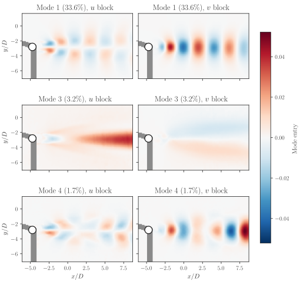{.light-content width=100%}
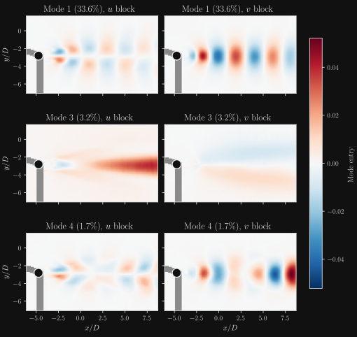{.dark-content width=100%}

*Component-wise views of modes 1, 3, and 4. All six panels share the same signed color scale.*

**Streamlines** trace curves tangent to a vector field. We can draw them through the mean flow or through the two components of an individual mode. A mode plot shows the spatial pattern for one choice of sign. In a snapshot, the sign and amplitude of its time coefficient determine the mode’s contribution to the velocity field.

{.light-content width=100%}
{.dark-content width=100%}

*Mean flow and three spatial modes. The mean streamlines are seeded more closely in the wake and colored by normalized mean speed. In the mode panels, thicker streamlines indicate larger mode-vector magnitudes on a shared scale.*

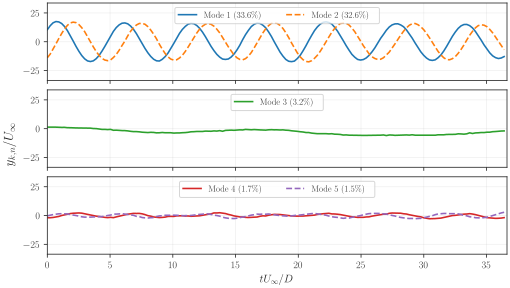{.light-content width=100%}
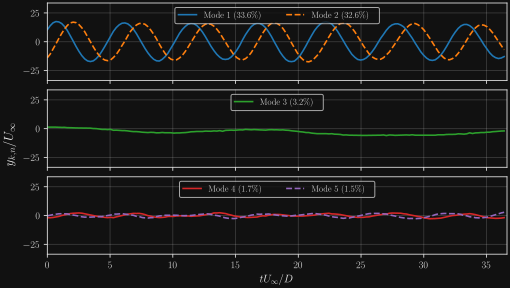{.dark-content width=100%}

*Eight-second excerpts on the same vertical scale. The POD uses the complete record.*

The first two coefficients oscillate with a phase offset, and their full records share a dominant peak near $0.89\,\mathrm{Hz}$, consistent with the reported shedding frequency [@tu2014spectral]. Mode 3 has a slower dominant variation, with its largest Fourier amplitude near $0.028\,\mathrm{Hz}$. Modes 4 and 5 both peak near $0.845\,\mathrm{Hz}$ and have similar variance contributions. We group them together to compare their time dependence.

### Spectra of individual POD time coefficients

The time histories show how the POD coefficients evolve. We can also ask which frequencies contribute to each coefficient. The figure uses the discrete Fourier transform introduced below to show the contribution of each frequency bin to the variance of modes 1, 3, 4, and 6.

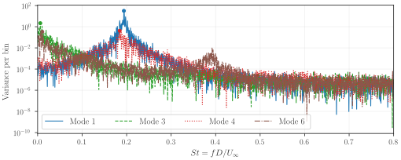{.light-content width=100%}
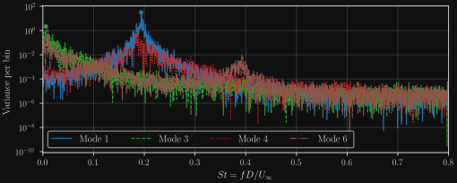{.dark-content width=100%}

*Spectra from the full record, with time coefficients scaled by $U_\infty$. The Strouhal axis is linear and the variance axis is logarithmic. Markers indicate the strongest bin in each curve.*

Mode 1 peaks at $St\approx0.194$ and mode 4 peaks nearby at $St\approx0.185$. Modes 3 and 6 have their largest peaks at much lower frequencies, near $St\approx0.006$ and $0.010$, respectively. Mode 6 also has a secondary peak near the second shedding harmonic. These spectra show that one POD mode can contain several frequencies and that the same frequency can contribute to several modes. POD orders spatial patterns by variance, so one mode can mix motions on different time scales. This motivates a Fourier decomposition, where we can examine the spatial pattern associated with a single frequency bin.

### Reconstructing the wake with up to five modes

We reconstruct a snapshot by mapping the time coefficients back to the measurement grid and adding the temporal mean:

$$
\widehat{\mathbf u}_r(t_n)=\overline{\mathbf u}
+\boldsymbol{\Phi}_r\mathbf y_n^{(r)}.
$$

The columns of $\boldsymbol{\Phi}_r$ are the $r$ retained spatial modes, each with its streamwise and transverse blocks stacked. The column vector $\mathbf y_n^{(r)}$ collects the corresponding time coefficients at snapshot $n$. For example, retaining modes 1 and 2 gives $\boldsymbol{\Phi}_2\in\mathbb R^{2P\times2}$ and $\mathbf y_n^{(2)}\in\mathbb R^2$.

The animations show four views of the same eight seconds on a shared color scale for each component. The mean alone shows the steady wake deficit. Adding modes 1 and 2 reveals the traveling shedding pattern. The lower panels add mode 3 alone and modes 4 and 5 together. In those panels we multiply only the modal fluctuations by three to make the weaker patterns visible. The mean field is added at its original amplitude.

#### Streamwise velocity

<video class="light-content" controls loop muted playsinline preload="metadata" width="100%" poster="media/coherent-piv-reconstruction-u-light.png" aria-label="Streamwise velocity for the mean, modes 1 and 2 at actual amplitude, and amplified mode 3 and modes 4 and 5"><source src="media/coherent-piv-reconstruction-u-light.mp4" type="video/mp4"></video>
<video class="dark-content" controls loop muted playsinline preload="metadata" width="100%" poster="media/coherent-piv-reconstruction-u-dark.png" aria-label="Streamwise velocity for the mean, modes 1 and 2 at actual amplitude, and amplified mode 3 and modes 4 and 5"><source src="media/coherent-piv-reconstruction-u-dark.mp4" type="video/mp4"></video>

#### Transverse velocity

<video class="light-content" controls loop muted playsinline preload="metadata" width="100%" poster="media/coherent-piv-reconstruction-v-light.png" aria-label="Transverse velocity for the mean, modes 1 and 2 at actual amplitude, and amplified mode 3 and modes 4 and 5"><source src="media/coherent-piv-reconstruction-v-light.mp4" type="video/mp4"></video>
<video class="dark-content" controls loop muted playsinline preload="metadata" width="100%" poster="media/coherent-piv-reconstruction-v-dark.png" aria-label="Transverse velocity for the mean, modes 1 and 2 at actual amplitude, and amplified mode 3 and modes 4 and 5"><source src="media/coherent-piv-reconstruction-v-dark.mp4" type="video/mp4"></video>

## What if we keep the mean?

Let $\mathbf A$ contain the raw snapshots and let $\boldsymbol{\mu}$ be the sample mean field. Then $\mathbf A=\mathbf X+\boldsymbol{\mu}\mathbf 1^\mathsf T$. Keeping the same normalization for comparison and using $\mathbf X\mathbf 1=\mathbf 0$, we obtain

$$
\mathbf B=\frac{\mathbf A\mathbf A^\mathsf T}{N-1}
=\mathbf C+\frac{N}{N-1}\boldsymbol{\mu}\boldsymbol{\mu}^\mathsf T.
$$

The raw SVD therefore ranks directions by their mean square about zero. The second term is the contribution of the mean, and $\mathbf C$ is the contribution of the fluctuations. For $\boldsymbol{\mu}\ne\mathbf 0$, write $\mathbf e=\boldsymbol{\mu}/\|\boldsymbol{\mu}\|$. The mean term points along $\mathbf e$ when applied to $\mathbf e$. Therefore $\mathbf e$ is an eigenvector of $\mathbf B$ exactly when it is also an eigenvector of $\mathbf C$.

Suppose $\mathbf C\mathbf e=\lambda_\mu\mathbf e$. Then the eigenvalue of $\mathbf B$ along $\mathbf e$ is $\lambda_\mu+N\|\boldsymbol{\mu}\|^2/(N-1)$. In every direction perpendicular to the mean, the mean term vanishes. Thus the leading raw mode is uniquely the normalized mean, up to sign, when

$$
\lambda_\mu+\frac{N}{N-1}\|\boldsymbol{\mu}\|^2
>
\max_{\substack{\mathbf q^\mathsf T\mathbf e=0\\ \|\mathbf q\|=1}}
\mathbf q^\mathsf T\mathbf C\mathbf q.
$$

At equality, the mean direction belongs to a tied leading eigenspace, so the computed leading vector may be another direction in that space. One simple case is when every centered snapshot is orthogonal to the mean. Then $\lambda_\mu=0$, and the mean leads if its contribution exceeds the largest fluctuation eigenvalue. If the mean is strong but its direction is coupled to other directions by $\mathbf C$, the first raw mode can be close to the mean while still mixing in fluctuations. If the sample mean is zero, the raw and centered analyses coincide.

## Discrete Fourier transform

POD learns a **spatial** basis from the snapshots and orders its modes by variance. The discrete Fourier transform (DFT) uses a prescribed **temporal** basis of complex sinusoids. It asks which frequencies contribute to the fluctuations and what spatial pattern accompanies each frequency.

### From a scalar signal to a field

For a scalar signal $q_n=q(t_n)$ sampled at $t_n=t_0+n\Delta t$, we use the following forward and inverse transforms:

$$
\begin{aligned}
\widehat q_k &= \sum_{n=0}^{N-1}q_n\,\exp\!\left(-\frac{2\pi\mathrm i nk}{N}\right),
& k&=0,\ldots,N-1,\\
q_n &= \frac{1}{N}\sum_{k=0}^{N-1}\widehat q_k\,\exp\!\left(\frac{2\pi\mathrm i nk}{N}\right),
& n&=0,\ldots,N-1.
\end{aligned}
$$

The frequency spacing is $\Delta f=1/(N\Delta t)$. The index $k=0$ represents the constant part. Indices above $N/2$ represent negative frequencies $(k-N)\Delta f$. For a real signal, positive and negative frequency coefficients are complex conjugates of one another. This lets us display a one-sided spectrum.

For a vector snapshot $\mathbf x_n\in\mathbb R^M$, each exponential is a scalar multiplier applied to the whole snapshot. The same sums therefore transform all spatial entries at once:

$$
\widehat{\mathbf x}_k=\sum_{n=0}^{N-1}\mathbf x_n\,\exp\!\left(-\frac{2\pi\mathrm i nk}{N}\right),
\qquad
\mathbf x_n=\frac{1}{N}\sum_{k=0}^{N-1}\widehat{\mathbf x}_k\,\exp\!\left(\frac{2\pi\mathrm i nk}{N}\right).
$$

The complex vector $\widehat{\mathbf x}_k$ gives the spatial distribution of amplitude and phase at frequency bin $k$. In the wake example it contains the streamwise and transverse blocks on the same grid as the snapshots.

### Fourier matrix and POD projection

Let $\zeta=\exp(-2\pi\mathrm i/N)$, the complex phase increment for one time step at the first nonzero frequency. The Fourier matrix $\mathbf F\in\mathbb C^{N\times N}$ contains its powers, with $F_{nk}=\zeta^{nk}$ for $n,k=0,\ldots,N-1$:

$$
\mathbf F =
\begin{bmatrix}
1 & 1 & 1 & \cdots & 1\\
1 & \zeta & \zeta^2 & \cdots & \zeta^{N-1}\\
1 & \zeta^2 & \zeta^4 & \cdots & \zeta^{2(N-1)}\\
\vdots & \vdots & \vdots & \ddots & \vdots\\
1 & \zeta^{N-1} & \zeta^{2(N-1)} & \cdots & \zeta^{(N-1)^2}
\end{bmatrix}.
$$

Column $k$ contains the weights for frequency bin $k$. The first column is all ones, so it adds the samples to give the zero-frequency coefficient. With snapshots along the columns, the transform acts on the right:

$$
\widehat{\mathbf X}=\mathbf X\mathbf F,\qquad
\mathbf X=\frac{1}{N}\widehat{\mathbf X}\mathbf F^\mathsf{H}.
$$

Here $\mathsf H$ denotes conjugate transpose, and $\mathbf F\mathbf F^\mathsf{H}=N\mathbf I_N$. The matrix shows the algebra of the transform. In practice, a fast Fourier transform (FFT) evaluates it without assembling $\mathbf F$.

Suppose the retained POD modes span the snapshot matrix, so $\mathbf X=\boldsymbol{\Phi}\mathbf Y$ exactly. Then

$$
\widehat{\mathbf X}
=(\boldsymbol{\Phi}\mathbf Y)\mathbf F
=\boldsymbol{\Phi}(\mathbf Y\mathbf F)
=\boldsymbol{\Phi}\widehat{\mathbf Y}.
$$

We can thus transform the POD time coefficients and recover each original Fourier vector by lifting it through the spatial basis. Exact recovery requires every POD direction with a positive singular value. The orthonormal columns of $\boldsymbol{\Phi}$ also preserve the norm of each frequency vector, so the spectrum can be computed directly in the reduced coordinates.

For a rank-$r$ truncation, $\boldsymbol{\Phi}_r\widehat{\mathbf Y}_r$ is the DFT of the rank-$r$ approximation to the snapshots. Truncation can suppress noise if the discarded directions mainly contain noise. It can also remove weak physical features. Once the POD is available, we compute $r$ FFTs of length $N$ instead of $M$. With $r\ll M$, this substantially reduces the Fourier work and storage, especially when we lift only a few selected frequency bins back to the grid.

### Fourier spectrum of the cylinder wake

We use the full time record of the first 20 POD coefficients of the mean-subtracted PIV fields. We use a boxcar window, so every sample has the same weight. The frequency axis is the Strouhal number $St=fD/U_\infty$. The 20 modes retain 79.3% of the original fluctuation variance. We divide the plotted bin energies by that retained variance and omit the zero-frequency bin. Each positive-frequency bin includes the contribution of its negative-frequency partner, with the Nyquist bin counted once.

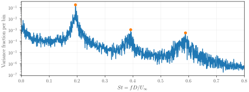{.light-content width=100%}
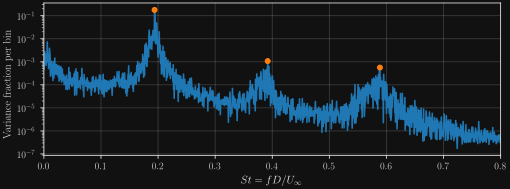{.dark-content width=100%}

The leading POD time coefficient and the projected DFT both peak at $f=0.8875\,\mathrm{Hz}$, giving $St=fD/U_\infty\approx0.194$. For the same PIV experiment, @tu2014spectral report a dominant DMD frequency of $0.889\,\mathrm{Hz}$, and @hemati2014streaming report $0.887\,\mathrm{Hz}$ from their streaming DMD. Both give $St\approx0.194$ with the same diameter and inflow speed. The frequency differences are smaller than the DFT bin spacing of $0.0025\,\mathrm{Hz}$.

The two weaker peaks at $St\approx0.392$ and $0.589$ lie near twice and three times the shedding frequency, consistent with the second and third harmonics reported for this flow [@tu2014spectral]. A harmonic at $kf_1$ completes $k$ oscillations during one period of the fundamental at $f_1$. The fundamental and its harmonics can describe a repeating shedding cycle whose waveform is more complex than a single sinusoid.

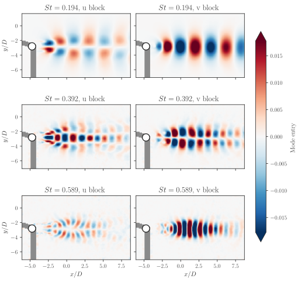{.light-content width=100%}
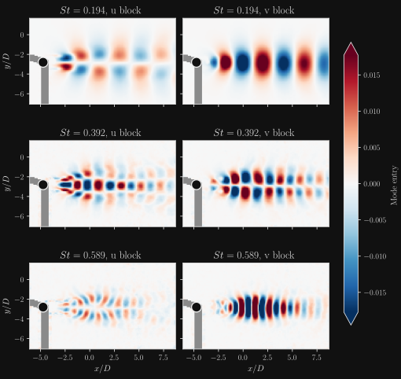{.dark-content width=100%}

*Real parts of the selected unit-norm Fourier modes on a shared symmetric color scale set by the 98th percentile of the absolute plotted entries. Values beyond the limits saturate. Each mode is rotated in complex phase so its largest-magnitude entry is real and positive. The plots show one phase of each pattern, while the spectrum above shows how much variance each frequency contributes.*

The animation advances the leading complex mode through one cycle. At phase $t/T$ we plot the real part of the mode multiplied by $\exp(2\pi\mathrm i t/T)$. Both velocity components use the same phase and fixed color limits. The animation shows the shape of the fluctuation without the mean field, and its playback is scaled to show one cycle clearly.

<video class="light-content" controls loop muted playsinline preload="metadata" width="100%" poster="media/coherent-piv-fourier-leading-light.png" aria-label="One phase cycle of the leading Fourier mode, showing both velocity components"><source src="media/coherent-piv-fourier-leading-light.mp4" type="video/mp4"></video>
<video class="dark-content" controls loop muted playsinline preload="metadata" width="100%" poster="media/coherent-piv-fourier-leading-dark.png" aria-label="One phase cycle of the leading Fourier mode, showing both velocity components"><source src="media/coherent-piv-fourier-leading-dark.mp4" type="video/mp4"></video>

## References

::: {#refs}
:::
